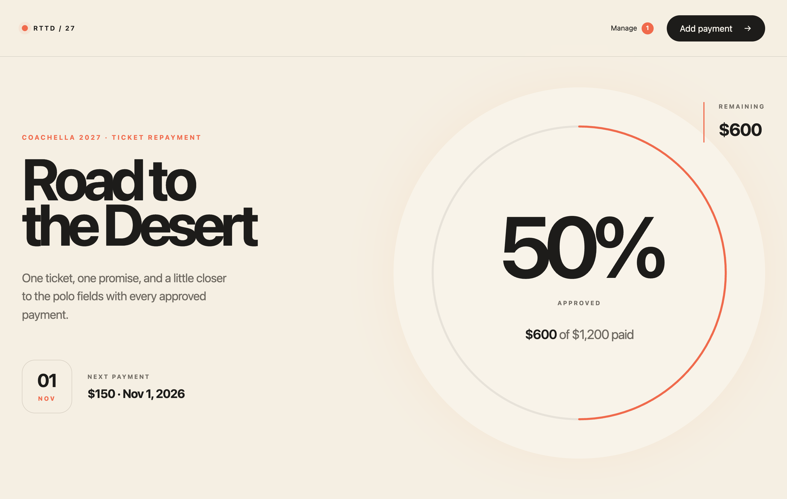
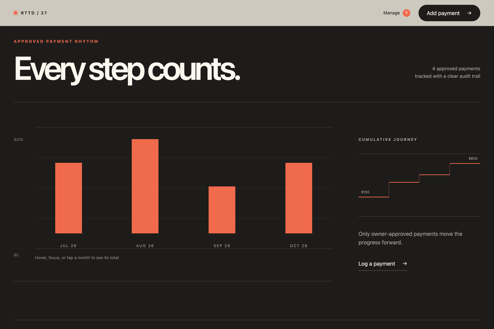
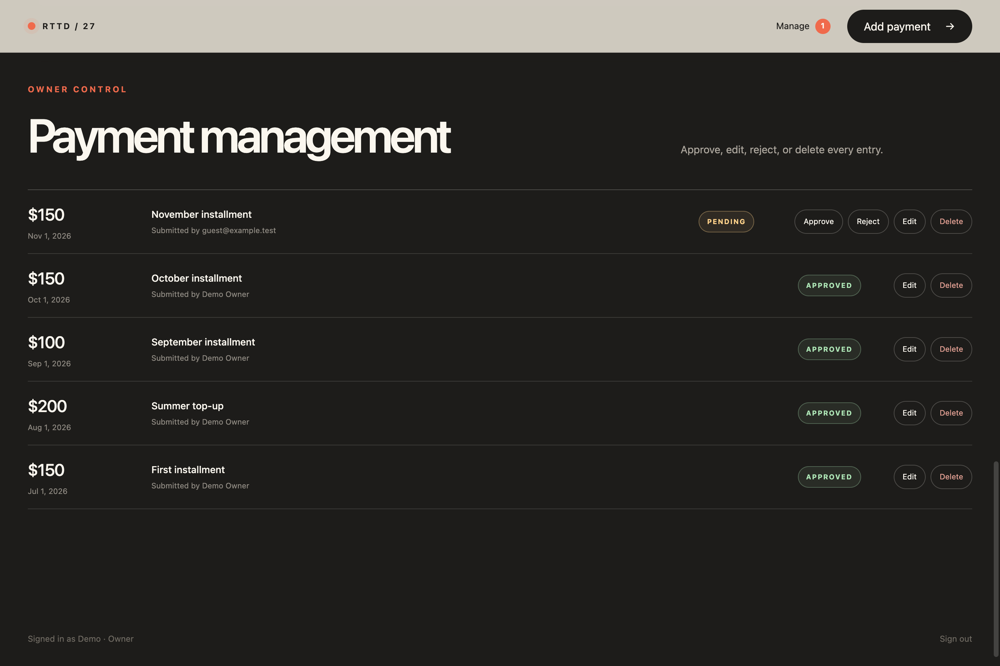
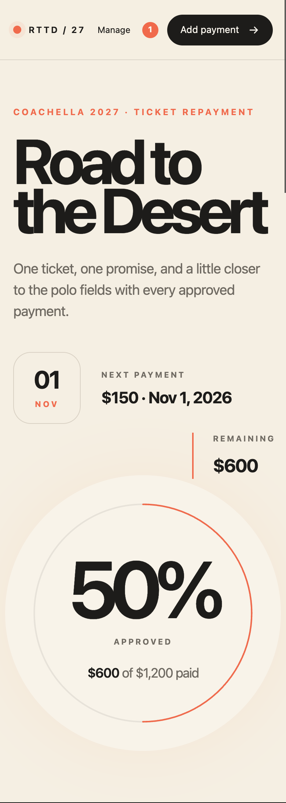
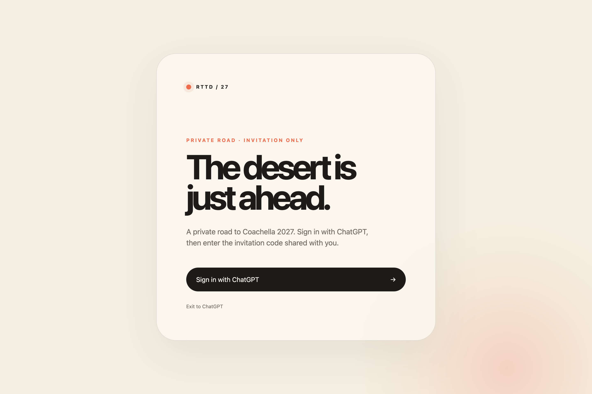

# Road to Coachella

A reusable, invitation-only ticket-repayment tracker with a desert-themed UI,
approved-payment progress, monthly charts, an owner review console, and a
user-triggered audiovisual easter egg. It records payments; it does **not**
process payments, move money, or verify that a payment actually occurred.

Built with React, TypeScript, the Next.js App Router API surface provided by
[Cloudflare vinext](https://github.com/cloudflare/vinext), Workers, and D1. This
is an OpenAI Sites-oriented application, **not a drop-in secure self-hosted
Next.js app**. Read [SECURITY.md](SECURITY.md) and [DEPLOYMENT.md](DEPLOYMENT.md)
before exposing it to the Internet. The pinned experimental toolchain has a disclosed unresolved build/lint glob
parser advisory; passing CI does not mean the complete dependency graph is
clean. See [DEPENDENCIES.md](DEPENDENCIES.md) for verified remediation and scope.

## Preview

Actual screenshots of the template running locally with **fictional demo data**.
Names, amounts, dates, and payment records are illustrative, not real financial
information. The optional photo/audio easter egg is disabled. These previews do
not demonstrate production authentication or a live deployment.

### Desktop dashboard



<details>
<summary>More previews: charts, owner controls, mobile, sign-in, and link-preview artwork</summary>

### Payment charts



### Owner payment management



### Mobile layout



### Invitation-only sign-in



### Web-link preview artwork

The existing artwork referenced by the app's Open Graph and social-card metadata.
This is promotional artwork, **not a screenshot of the interface**.


</details>

## Fresh-clone setup

Use Node **22.22.3** (the version in `.nvmrc`) and npm 10.9.8 or a compatible npm
10 release. Node's TypeScript stripping and VM modules are explicitly enabled
by the test script. No global Wrangler install or Cloudflare account is needed
for local development, tests, or the build.

```bash
git clone https://github.com/Mushy-Snugglebites-badonkadonk/road-to-coachella.git
cd road-to-coachella
nvm install
nvm use
npm ci
cp .env.example .env
npm run dev
```

The clone URL is the intended public repository location; publication is a
separate maintainer action. If using another fork, substitute its clone URL.
The dev server is bound to loopback (normally `http://localhost:3000`). The fresh
app displays the invitation/sign-in screen because local development has no
Sites OAuth gateway. The gateway-owned sign-in links do not implement local
OAuth. See the local-only identity check below to exercise the owner screen.

### Required configuration

Edit your ignored `.env` for local development. Use your Sites deployment
control plane's runtime bindings/secrets for production; `.env` is **not** a
production secrets deployment mechanism.

| Variable | Default | Purpose |
| --- | --- | --- |
| `OWNER_EMAIL` | blank | Verified ChatGPT email allowed to administer the app; blank grants nobody ownership. |
| `OWNER_DISPLAY_NAME` | `Owner` | Public-facing owner label; never used as an identity credential. |
| `INVITE_CODE_SECRET` | blank | Exactly 32 random bytes encoded as base64url, used for AES-GCM invitation-code encryption. |
| `TRACKER_TOTAL_CENTS` | `0` | Your positive safe-integer repayment total in USD cents. |
| `TRACKER_INSTALLMENT_CENTS` | `0` | Your positive safe-integer regular installment in USD cents. |
| `TRACKER_ANCHOR_DATE` | blank | Your first outstanding installment date, `YYYY-MM-DD`, a real calendar date. |
| `EASTER_EGG_ENABLED` | `false` | Set exactly `true` to opt into the bundled noncommercial image/audio. Disabled routes return 404 and the UI does not request media. |
| `SITE_URL` | blank | Explicit canonical HTTPS origin for metadata; HTTP is accepted only for loopback. Blank/invalid falls back to `http://localhost:3000`, never a production address or incoming Host header. |

Generate the invitation secret locally and put the result in your ignored
`.env`; do not commit it or send it to a public issue:

```bash
node -e "console.log(require('node:crypto').randomBytes(32).toString('base64url'))"
```

All financial defaults are zero/blank. Until **all three** financial settings
are valid, the owner/authorized tracker displays **Configuration required**,
progress is safely zero, and payment `POST`, `PATCH`, and `DELETE` return HTTP
503 without changing the payment ledger. A zero default is **not** a paid-off
balance. The pure parser and defaults live in `app/tracker-config.ts`, with
Worker environment access in `app/server-config.ts`.

No payment history, accounts, invite codes, or grants are seeded. Synthetic
balances and dates appear only in tests. Choose your own real values; restart
the dev server after changing `.env`. Settings are authoritative runtime values,
not an editable user preference in the web UI. They are mirrored into the
`tracker_settings` D1 row to support atomic SQL total limits. Do not edit that
row to configure the app: the next tracker operation will overwrite it.

### How `.env` becomes a Worker binding

This project does not use a source `wrangler.jsonc`. In `vite.config.ts`, Vite's
`loadEnv(mode, projectRoot, "")` loads the selected local environment. An explicit
allowlist is passed through the Cloudflare Vite plugin's `config.vars` option
**only when Vite is serving**, making the values available via
`cloudflare:workers` `env`. Process environment values take precedence according
to Vite's loader. Nothing is prefixed `VITE_`, and the app does not use
`NEXT_PUBLIC_` for secrets.

A plain `.env` file or `process.env` read alone would not provide these explicit
Worker bindings. The plugin's installed TypeScript API accepts `config` as a
Worker configuration/customizer; this implementation uses its supported `vars`
field. The build intentionally excludes all local vars so an invitation key
cannot be copied into `dist/server/wrangler.json`. Inject runtime values at
production deployment, not by removing that safeguard.

### Local-only identity check

On an isolated loopback dev server, after setting `OWNER_EMAIL=owner@example.test`
in your local `.env`, this synthetic request exercises the owner API:

```bash
curl -i http://localhost:3000/api/payments \
  -H 'oai-authenticated-user-email: owner@example.test'
```

To view the tracker locally, use a local browser development tool that attaches
that synthetic header to requests to **loopback only**. Never put a mock identity
in production code or broaden this testing pattern to a public deployment.
Requests without a trusted identity stay on the invitation screen / receive
401 for the payment API. This local ability to supply the header is exactly why
an unauthenticated public Worker deployment would be insecure.

## Payment and invitation behavior

- The configured owner adds approved payments directly and can approve, reject,
  edit, or delete records. Owner mutations enforce the configured total in SQL.
- Invited users submit pending payments and view their own submissions. Only
  approved payments contribute to the shared ledger and aggregate progress.
  All invitees can see approved amounts and payment dates (plus row IDs/status),
  but not other participants' identifiers, notes, or review/creation timestamps.
  Their own entries remain visible; the owner retains the full audit ledger.
- At most ten pending submissions per user are accepted. Notes are capped at
  80 characters; calendar dates and amount bounds are checked server-side.
- Approved payments on or after the anchor consume installment credit.
  Historical payments reduce the balance without consuming the anchored
  schedule. Partial payments combine, month ends clamp, and the final amount is
  capped by the remaining balance. Edits/deletions recalculate the schedule.
- The owner issues single-use, expiring invitation codes. Redemption requires
  a signed-in identity; persistent D1 grants are revocable. Invitation links
  use an opaque share token, not a sequential invitation ID.
- Private media is served by authorized `/api/media/easter-egg-face` and
  `/api/media/easter-egg-audio` routes with no-store headers, not static paths.
  The raw media is deliberately included in the public source repository: it
  is not secret merely because it is stored in a folder named `private/`.

## Database and platform setup

`.openai/hosting.json` declares a D1 binding named `DB`, no R2 binding, and an
obvious project-ID placeholder. Replace the ID with your own Sites project ID
using your authorized hosting workflow. There are no production project IDs,
database IDs, hostnames, personal balances, or old financial data migrations in
this release. The UUID in `vite.config.ts` is a local placeholder, not a remote
resource.

`drizzle/0000_initial_schema.sql` is the clean schema for a **new** database. The
Drizzle schema lives in `db/schema.ts`; the migration journal contains just this
initial migration. There is no configured `db:generate` command. Local routes
also initialize missing tables, so a fresh loopback preview works without manual
SQL setup. Production migration handling and runtime binding requirements are
covered in [DEPLOYMENT.md](DEPLOYMENT.md).

Do not apply this reset migration over an existing personal deployment. It is
not an upgrade/cleanup migration and contains no legacy data conversion. Use a
new database for a fork or plan a separate reviewed migration.

## Verify and build

```bash
npm run lint
npm run typecheck
npm test
npm run build
```

The tests execute real scheduling/configuration/validation helpers and actual
routes with synthetic identities. SQLite regressions use Node 22's `node:sqlite`
against the actual route SQL and bindings, with transactional batches and
controlled interleavings for revocation, duplicate claims, expiry, and payment
approval/edit races. Shared-ledger privacy is checked through real GET responses.
Other unit tests stub the D1 boundary to cover zero-state safety, unconfigured
mutation rejection, configured mutation paths, amount/date validation,
same-origin checks, metadata origins, and private-media source boundaries.
These tests do not exercise a deployed D1 service or production OAuth gateway
and do not replace a deployment security review.

The build produces `dist/` and packages Sites metadata/migrations under
`dist/.openai/`. `npm run start` is a local production preview, **not** a secure
public deployment command. CI uses Node from `.nvmrc` and runs `npm ci`, lint,
typecheck, tests, and build without real credentials. Review `npm audit` as a
separate dependency-security gate; no automatic breaking upgrades are made.

## Repository layout

- `app/`: UI, request identity, access rules, payment API, private-media routes.
- `worker/`: vinext Worker entry and response-security headers.
- `build/sites-vite-plugin.ts`: build-only Sites metadata/migration packaging.
- `db/`, `drizzle/`: D1 schema and clean initial migration.
- `private/`: intentionally bundled raw easter-egg media.
- `public/`: neutral preview, favicon/graphics, crawler exclusion.
- `tests/`: explicit synthetic fixtures; no personal ledger.
- `examples/d1/`: optional generic Drizzle example, not part of the tracker UI.

`.env*` (except `.env.example`), `.dev.vars*`, `.wrangler/`, `dist/`, `work/`,
`node_modules/`, caches, and local databases must remain uncommitted. Do not
publish runtime exports or generated bundles that could contain private data.

## Optional / replaceable easter egg

The easter egg is **off by default** (`EASTER_EGG_ENABLED=false`). When off,
its trigger/image/audio elements are not rendered and both media endpoints return
404. Enabling it is an explicit runtime opt-in, not part of payment tracking.

For commercial code reuse, keep it disabled and **remove all CC BY-NC media
from your distributed source/build** or obtain separate commercial permission.
Disabling alone is not a license change: the raw files remain in a clone and
are still embedded by the server's inline imports. A buildable replacement path
is to replace `private/easter_egg.jpg` and `private/easter_egg.m4a` with your own
properly licensed assets before building. The project preview graphics under
`public/` do not carry the Easter Egg's noncommercial restriction. Retain
the expected image/audio formats and dimensions/crop behavior, or update
`app/private-media.ts`, `app/tracker.tsx`, and their CSS to remove/rework the
feature entirely. Update the asset attribution notice to reflect only your own
verified replacement rights. A replacement voice may need a different
`JAW_ENVELOPE` animation profile and `EASTER_EGG_PHRASE` text.

## Licensing, attribution, and development disclosure

Code and documentation: **MIT**, copyright 2026
**Mushy-Snugglebites-badonkadonk**. Only the two bundled Easter Egg photo/audio
files are **CC BY-NC 4.0**, with scope, permissions, and attribution in
[ASSET-LICENSE.md](ASSET-LICENSE.md). Preview graphics remain under MIT, subject
to retained third-party notices.
The retained raw media is credited to **Paris**; this release
does not invent creator identities or assert independently verified ownership.
Commercial code reuse is allowed under MIT; replace the noncommercial media or
obtain separate permission for commercial media use. Third-party packages keep
their own licenses, and festival/product trademarks are not licensed by this
project. This project is not affiliated with Coachella, OpenAI, or Cloudflare.

AI-assisted tools were used in development, documentation, and testing. Human
review remains necessary for security, licensing, deployment, and maintenance.
